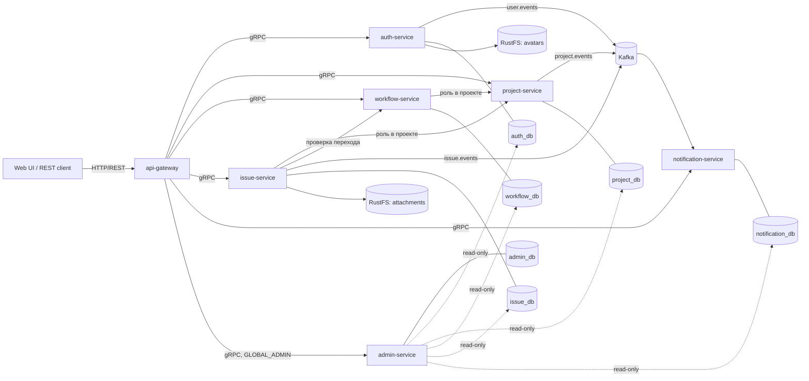

# Taska Backend

Backend системы управления проектами и задачами (аналог Jira). Проект построен как реактивный Java-монорепозиторий: внешний REST API принимает `api-gateway`, синхронное взаимодействие сервисов идёт по gRPC, доменные события доставляются через Kafka по шаблону transactional outbox, а каждый бизнес-сервис владеет отдельной PostgreSQL-базой.

## Текущее состояние

Реализованы:

- аутентификация по JWT, refresh-token rotation, блокировка после неудачных входов, приглашение пользователей и личные PAT со scopes read/write;
- профиль пользователя и загрузка аватара через presigned URL;
- проекты, участники и роли `ADMIN`, `MEMBER`, `VIEWER`;
- настраиваемые workflow, статусы и проверка допустимости переходов;
- создание, просмотр, изменение, удаление, назначение, переходы и параметризованный поиск задач;
- история задач, комментарии и связи между задачами;
- проектные метки и привязка меток к задачам;
- вложения задач через S3-совместимое хранилище;
- наблюдатели задач, включая подписку текущего пользователя и управление наблюдателями;
- in-app и email-уведомления на основе Kafka-событий;
- административный read-only просмотр таблиц, маскирование чувствительных данных, журнал аудита и сводка проблемных outbox-событий;
- метрики Prometheus, дашборды Grafana и централизованные логи Loki/Promtail;
- автоматический AI review pull request с провайдерами OpenAI Codex или DeepSeek.

REST-контракт является источником истины для публичного API: [`api-gateway/src/main/resources/static/openapi.yml`](api-gateway/src/main/resources/static/openapi.yml). `/v3/api-docs` публикует этот же документ в JSON; интеграционный тест в CI проверяет совпадение с `/openapi.yml`. Справочная модель из аннотаций Springdoc доступна отдельно по `/v3/api-docs/generated`.

Приглашения и каталог пользователей: [правила, пограничные случаи и выкатка TAS-204](docs/tas-204-invitations-and-directory.md).

Каналы уведомлений Email/Telegram: [подключение бота, настройки пользователя и доставка TAS-387](docs/tas-387-telegram-notifications.md).

Поле пользователя `login` удалено (TAS-388): вход выполняется по email, постоянный идентификатор — UUID, имя для отображения — `displayName`. Аудит сохраняет UUID и снимки имени/email автора. Исторические обозначения авторов сохранены как `actorDisplayName`, их email остаётся неизвестным. Обновление требует согласованной выкладки auth-service, api-gateway, admin-service и фронта (TAS-389); смешанные старые/новые версии контрактов не поддерживаются. Перед миграцией сохранить резервные копии БД; откат требует восстановления схемы и данных из копии. Старые Liquibase changesets не изменяются.

Удаление типа задачи с переносом: [контракт, блокировки и восстановление TAS-433](docs/tas-433-issue-type-deletion.md).

[Типы задач и workflow — TAS-436](docs/tas-436-workflow-type-bindings.md).

## Архитектура



Внешнему клиенту нужен только `api-gateway`. HTTP-порты остальных сервисов предназначены прежде всего для Actuator; бизнес-контракты между сервисами опубликованы в `grpc-common-lib/src/main/proto`.

### Модули

| Модуль | Назначение |
|---|---|
| `mcp-server` | Streamable HTTP `/mcp`, PAT, request-scoped auth context и вызовы REST gateway; 22 инструмента чтения и записи задач, проектов, доски, комментариев, worklogs и уведомлений |
| `api-gateway` | REST/BFF, OpenAPI, CORS, проверка access-токена и формирование контекста запроса |
| `auth-service` | пользователи, credentials, JWT, refresh/invite tokens, профиль и аватары |
| `project-service` | проекты, участники, проектные роли и события проектов |
| `workflow-service` | workflow, статусы, переходы и правила валидации |
| `issue-service` | задачи, поиск, история, комментарии, связи, метки, вложения и наблюдатели |
| `notification-service` | Kafka consumer, дедупликация событий, inbox и email-доставка |
| `admin-service` | глобальный административный read-only API, маскирование, аудит и мониторинг outbox |
| `common-lib` | общие доменные типы, события, исключения и R2DBC-конвертеры |
| `grpc-common-lib` | protobuf-контракты и сгенерированные gRPC/Reactor stubs |
| `kafka-lib` | общая реализация transactional outbox |
| `storage-lib` | реактивный S3-клиент и presigned URL |
| `metrics-starter` | автоконфигурация и аспект прикладных метрик |

### Основной стек

- Java 21;
- Spring Boot 4.0.3 и Spring WebFlux;
- Spring Data R2DBC и PostgreSQL 16;
- Spring gRPC, Protocol Buffers и Reactor gRPC;
- Kafka в KRaft-режиме;
- Liquibase;
- RustFS / AWS SDK v2;
- Prometheus, Grafana, Loki и Promtail;
- JUnit 6, Mockito и Testcontainers.

## Быстрый локальный запуск

### Требования

- JDK 21;
- Docker Engine с Compose v2;
- свободные локальные порты из таблицы ниже.

Maven устанавливать отдельно не требуется: в репозитории есть wrapper.

### 1. Подготовить окружение

Docker Compose использует корневой `.env` и для `env_file`, и для подстановки `${...}` в compose-файлах. Перед первым запуском создайте его из dev-шаблона.

PowerShell:

```powershell
Copy-Item .env.docker.example .env
```

Bash:

```bash
cp .env.docker.example .env
```

`.env` игнорируется Git. Значения из `.env.docker.example` предназначены только для локальной разработки.

### Журнал миграций auth-service

Auth выбирает схему журнала Liquibase независимо от PostgreSQL `search_path`: новая БД использует `public`, существующая — полный совместимый журнал в `public` или `taska`. Частичный второй журнал после неудачного старого запуска не переигрывается и не удаляется. При несовместимых историях запуск останавливается до миграций: нужно проверить обе истории и явно выбрать проверенную схему через `SPRING_LIQUIBASE_LIQUIBASE_SCHEMA`. Явно заданные `spring.liquibase.liquibase-schema` и `spring.liquibase.default-schema` сохраняют приоритет. Сами changesets не изменяются; перенос, очистка и автоматическое слияние журналов не выполняются.

### 2. Проверить Compose

```bash
docker compose -f docker-compose.yml -f docker-compose.dev.yml --profile infra --profile services config --quiet
```

### 3. Запустить систему

Весь стек:

```bash
docker compose -f docker-compose.yml -f docker-compose.dev.yml --profile infra --profile services up -d --build
```

Только инфраструктура:

```bash
docker compose -f docker-compose.yml -f docker-compose.dev.yml --profile infra up -d
```

Один сервис вместе с зависимостями, например `issue-service`:

```bash
docker compose -f docker-compose.yml -f docker-compose.dev.yml --profile infra --profile services up -d --build issue-service
```

Состояние контейнеров и последние логи:

```bash
docker compose ps
docker compose logs --tail=100 api-gateway
```

Остановка без удаления данных:

```bash
docker compose -f docker-compose.yml -f docker-compose.dev.yml down
```

Команда `docker compose down -v` дополнительно удаляет PostgreSQL, Kafka, Grafana, Prometheus и RustFS volumes. Используйте её только для осознанного полного сброса локальных данных.

## Локальные адреса

### Приложение

| Компонент | HTTP / Actuator | gRPC |
|---|---:|---:|
| `api-gateway` | `http://127.0.0.1:8080` | — |
| `auth-service` | `http://127.0.0.1:8081` | `127.0.0.1:9091` |
| `project-service` | `http://127.0.0.1:8082` | `127.0.0.1:9096` |
| `workflow-service` | `http://127.0.0.1:8083` | `127.0.0.1:9093` |
| `issue-service` | `http://127.0.0.1:8084` | `127.0.0.1:9094` |
| `notification-service` | `http://127.0.0.1:8085` | `127.0.0.1:9095` |
| `admin-service` | `http://127.0.0.1:8086` | `127.0.0.1:9097` |
| `mcp-server` | `http://127.0.0.1:8087/mcp` | — |

Health check gateway:

```bash
curl http://127.0.0.1:8080/actuator/health
```

### Инфраструктура

| Компонент            | Адрес |
|----------------------|---|
| Swagger UI           | [http://127.0.0.1:8080/swagger-ui.html](http://127.0.0.1:8080/swagger-ui.html) |
| OpenAPI YAML         | [http://127.0.0.1:8080/openapi.yml](http://127.0.0.1:8080/openapi.yml) |
| OpenAPI JSON         | [http://127.0.0.1:8080/v3/api-docs](http://127.0.0.1:8080/v3/api-docs) |
| Kafka UI             | [http://127.0.0.1:8088](http://127.0.0.1:8088) |
| Grafana              | [http://127.0.0.1:3000](http://127.0.0.1:3000) |
| Prometheus           | [http://127.0.0.1:9090](http://127.0.0.1:9090) |
| Loki                 | `http://127.0.0.1:3100` |
| RustFS API / Console | `http://127.0.0.1:9000` / [http://127.0.0.1:9001](http://127.0.0.1:9001) |
| pgAdmin              | [http://127.0.0.1:5050](http://127.0.0.1:5050) |
| Kafka broker         | `127.0.0.1:9092` |
| PostgreSQL DB        | `127.0.0.1:5433`–`5438` |

PostgreSQL-порты по порядку: `auth`, `project`, `workflow`, `issue`, `notification`, `admin`.

pgAdmin требует входа по `PGADMIN_DEFAULT_EMAIL` / `PGADMIN_DEFAULT_PASSWORD`. После входа группа Taska содержит подключения ко всем шести БД. Пароли берутся из runtime environment и записываются только внутри volume в `.pgpass` с правами 0600; в репозитории их нет. При переходе с desktop mode создаётся отдельная учётная запись администратора и резервная копия конфигурационной БД `pgadmin4.db.pre-tas-302`; существующие пользователи и серверы сохраняются. Смена значения `PGADMIN_DEFAULT_PASSWORD` сама по себе не меняет пароль уже существующей учётной записи. Список серверов импортируется один раз при создании пользователя; последующие ручные настройки сохраняются. Пароль PostgreSQL в `.pgpass` обновляется при каждом старте. Изменения хостов или имён БД для уже созданного пользователя применяются через Import/Export из `/tmp/taska-pgadmin-servers.json`. HTTP smoke запускается командой `python3 infra/pgadmin/smoke.py` с переменными `PGADMIN_CHECK_URL`, `PGADMIN_DEFAULT_EMAIL` и `PGADMIN_DEFAULT_PASSWORD`.

Реестр типов проекта задаёт названия/цвета/значки и порядок: `sortOrder ASC`, затем `code` по collation C. `PUT /projects/{projectId}/issue-types/order` принимает полную перестановку кодов и атомарно назначает 10/20/30; первая запись становится типом по умолчанию. `/meta.issueTypes` содержит только имена начального посева.

Поколение записи типа — внутренний UUID жизненного цикла. После удаления или повторного создания кода старый workflow binding исключается из разрешения, списка и редактирования. Старые строки binding физически удаляются при создании нового workflow для этого кода, в той же локальной транзакции, что и новая привязка. Удаление реестра не меняет чужую БД до commit, поэтому его откат сохраняет прежнюю привязку. Миграции project-service и workflow-service и новые gRPC-контракты нужно выкладывать согласованно; старые версии не проверяют поколение. Идентификаторы поколений и их детерминированный backfill для legacy-данных не являются секретами или средствами авторизации.

## API и безопасность

OAuth login/registration for Google, GitHub and Apple is implemented behind configured provider credentials (TAS-424). The protocol, scoped secret-file setup, callback URLs and local verification are documented in [OAuth setup](docs/tas-424-oauth.md).

Публичные endpoints: login, refresh, preview и принятие приглашения. Остальные пользовательские операции требуют `Authorization: Bearer <access-token>`. Read-only административные endpoints дополнительно требуют глобальную роль `GLOBAL_ADMIN`.

Personal access tokens are implemented in auth-service (TAS-401). Secrets use `tsk_pat_` plus 256 random bits; only their SHA-256 hashes are stored. Tokens have `read` or `read,write` scopes, expire after 30 days by default, and are listed/revoked only through the owner's JWT session. `AUTH_PAT_MAX_LIFETIME_DAYS` defaults to 90 and `AUTH_PAT_MAX_ACTIVE_TOKENS` to 10. LOCKED accounts temporarily suspend PAT validation; blocking, account deletion and password replacement invalidate tokens permanently. Creation/revocation events produce private owner inbox/email notifications (email preferences apply), without token names or secrets.

Rollout: deploy auth-service first. PAT validation through gRPC requires `allow_personal_token=true`; older gateways omit it and continue rejecting PAT. Only enable it in clients that enforce scopes and deny PAT access to all admin endpoints (TAS-402/TAS-403). A PAT never grants administrative access through `GLOBAL_ADMIN` in its user context.


TAS-420: `PATCH /api/v1/users/me` changes only `displayName` and returns the full profile, including the normalized name and avatar availability. `PATCH /api/v1/admin/users/{userId}` requires a global administrator and records the previous/new name in the existing admin audit path. All name inputs share trim + 1–128 Unicode code points validation; controls and line breaks return `400` with `details.reason=DISPLAY_NAME_INVALID`. Live profile/directory lookups reflect renames; existing notification actor snapshots keep their historical name.

`POST /api/v1/auth/invitations/preview` accepts a token only in the body and returns email, name, INVITATION/SIGNUP kind and expiry without consuming it. Acceptance optionally replaces the invited name; an omitted name preserves it, and validation failures leave the token usable. The `users.created_via` migration defaults existing accounts to INVITATION and supports SIGNUP/OAUTH for subsequent registration providers. Deploy the auth migration/service and updated gRPC consumers together before enabling the new REST operations.

Основные группы REST API:

- `/api/v1/auth`, `/api/v1/users/me`;
- `/api/v1/projects` и участники проектов;
- `/api/v1/issues`, поиск, назначение и переходы;
- `/api/v1/projects/{projectId}/issues/{issueId}/comments`;
- `/api/v1/issues/{issueId}/links`;
- `/api/v1/projects/{projectId}/labels` и метки задач;
- `/api/v1/projects/{projectId}/issues/{issueId}/watchers`;
- `/api/v1/notifications`;
- `/api/v1/meta` — словари допустимых значений перечислений;
- `/api/v1/readonly` для глобального администратора.

Ограничения проектных операций задаются переменными `ISSUE_*_ROLES`. Полный состав запросов, ответов, статусов и параметров находится в OpenAPI-файле.

### Production checklist

Перед запуском вне локальной машины обязательно:

- заменить `JWT_SECRET`, `ADMIN_PASS`, пароли PostgreSQL, RustFS, Grafana и pgAdmin на уникальные секреты;
- задать SMTP credentials только через secret storage или переменные окружения, не коммитить их в Git;
- создать для `ADMIN_RO_*` отдельных PostgreSQL-пользователей только с правом `SELECT`; локальный пользователь `taska` не является read-only;
- не публиковать наружу gRPC, PostgreSQL, Kafka, RustFS API, Loki, Prometheus, pgAdmin и Kafka UI;
- ограничить `GATEWAY_CORS_ALLOWED_ORIGINS` доверенными HTTPS-origin;
- защитить внутреннюю сеть и межсервисный gRPC (mTLS или service identity), поскольку пользовательский контекст передаётся внутренними запросами;
- хранить `.env` вне репозитория и ротировать секрет сразу после подозрения на раскрытие;
- настроить резервное копирование баз и object storage, retention логов/метрик и алерты на `FAILED`/застрявшие outbox-события.

## Данные, события и файлы

Каждый сервис применяет собственные Liquibase-миграции при старте. Auth, project и issue сервисы сохраняют доменное изменение и outbox-событие в одной транзакции; publisher атомарно забирает пачку `NEW`-событий через `FOR UPDATE SKIP LOCKED`, публикует её в Kafka и переводит запись в `PUBLISHED` либо `FAILED`. Notification-service дедуплицирует входящие события по `event_id`.

Kafka topics:

| Topic | Producer | Consumer |
|---|---|---|
| `user.events` | `auth-service` | `notification-service` |
| `project.events` | `project-service` | `notification-service` |
| `issue.events` | `issue-service` | `notification-service` |

После исчерпания consumer retries сообщение направляется в topic `<source-topic>.DLT`.

`rustfs-init` создаёт buckets:

| Bucket | Содержимое |
|---|---|
| `taska-avatars` | аватары пользователей |
| `taska-attachments` | вложения задач |

Имена buckets, лимиты файлов, разрешённые MIME-типы и TTL presigned URL настраиваются через `.env` и `application.yml` соответствующего сервиса.

## Admin read-only API

`admin-service` предоставляет глобальному администратору:

- каталог доступных сервисов, таблиц и колонок;
- пагинацию, сортировку и типизированные фильтры `equals`, `contains`, `from`, `to`;
- получение строки по UUID primary key;
- маскирование настроенных колонок и полей JSON;
- аудит административных чтений в `admin_db`;
- сводку событий outbox в состояниях `FAILED` и просроченном `NEW`.

SQL-идентификаторы проверяются по фактическим метаданным, а значения фильтров передаются параметрами. Конфигурация разрешённых таблиц и чувствительных полей находится в `admin-service/src/main/resources/application.yml`. Подробности datasource — в [`admin-service/README.md`](admin-service/README.md).

## Наблюдаемость

Actuator публикует `health`, `info` и `prometheus`. Метрики собираются Prometheus, Grafana автоматически загружает дашборды метрик и логов, а Promtail отправляет Docker-логи в Loki.

### Дашборды Grafana

Исходники дашбордов находятся в `infra/grafana/dashboards/`. Локально Grafana доступна по адресу [http://127.0.0.1:3000](http://127.0.0.1:3000), на стенде — [https://grafana.taska.ozero.dev](https://grafana.taska.ozero.dev).

**Taska-metrics** — основной операционный дашборд. Показывает состояние каждого сервиса, HTTP- и gRPC-латентность, throughput и ошибки, утилизацию R2DBC-пула, I/O, JVM-память, CPU, GC и потоки. Подходит для повседневного мониторинга и расследования инцидентов.

**Taska - Post-deploy Overview** — дашборд наблюдаемости после автодеплоя. Позволяет быстро подтвердить, что новая версия успешно запустилась и работает штатно: scrape-статус всех инстансов, liveness/readiness пробы, версия и коммит сборки, состояние соединений с PostgreSQL и Kafka, динамика HTTP-ошибок и времени ответа, базовые JVM-метрики.

**AC Taska Logs** — централизованный просмотр логов из Loki. Агрегирует Docker-логи всех сервисов с фильтрацией по сервису, request ID, node ID и уровню логирования.

Promtail получает `DEPLOY_ENVIRONMENT` из Compose (по умолчанию `local`) и добавляет его как label `environment`. На стенде задайте `DEPLOY_ENVIRONMENT=stage`; в AC Taska Logs окружение выбирается фильтром «Окружение». После изменения настройки пересоздайте контейнер Promtail.

В логах и ответах gateway используется сквозной `X-Request-Id`. Для поиска запроса в Grafana доступны фильтры сервиса, request ID, node ID и уровня логирования.

## Сборка и тесты

Компиляция и упаковка всех модулей без тестов:

```powershell
.\mvnw.cmd -DskipTests package
```

```bash
./mvnw -DskipTests package
```

Стандартный набор тестов:

```powershell
.\mvnw.cmd test
```

```bash
./mvnw test
```

Часть интеграционных тестов называется `*IntegrationTest` и входит в стандартный запуск; для неё должен быть доступен Docker/Testcontainers. Классы с суффиксом `*IT` текущей Maven-конфигурацией автоматически не выбираются. До подключения Maven Failsafe их можно запустить явно:

```bash
./mvnw test -Dtest="*IT,*IntegrationTest" -Dsurefire.failIfNoSpecifiedTests=false
```

Тест одного модуля с зависимостями:

```bash
./mvnw -pl issue-service -am test
```

В pull request CI запускает Maven verify по матрице модулей. Docker images собираются только для PR с label `docker`. Отдельный workflow выполняет структурированный AI review, если repository variable `AI_REVIEW_ENABLED=true`.

AI review ведёт одну сводку в PR и не повторяет себя между пушами:

- первый прогон проверяет весь PR, следующие — только строки, изменённые с последнего проверенного коммита (он хранится в скрытом маркере сводки); после force-push ревью снова полное, а пуш без изменений в файлах PR и перезапуск старого прогона пропускаются;
- модель видит прошлые треды бота: resolved больше не поднимаются, по открытым в сводке остаётся ссылка-напоминание, исправленные помечаются ✅ в самом треде; тред, переоткрытый вручную, бот больше не закрывает;
- inline публикуются замечания не ниже `AI_REVIEW_INLINE_MIN_SEVERITY` и не больше `AI_REVIEW_MAX_INLINE` за прогон; значимые замечания сверх лимита (или к строкам, которые GitHub не принимает) показываются в сводке целиком, мелкие — свёрнутым списком;
- если diff не помещается в `DEEPSEEK_MAX_DIFF_LINES`, контекст вокруг изменений сокращается, а файлы, которые всё равно не поместились, перечислены в сводке как непроверенные;
- если в заголовке PR или имени ветки есть ключ задачи (`TAS-123`), описание задачи из Jira добавляется в контекст модели, а в сводке появляется раздел «Соответствие задаче». В публичном репозитории это включается только при `AI_REVIEW_JIRA_IN_PUBLIC_REPO=true`: Codex печатает в лог Actions всё, что читает, а логи и комментарии публичного репозитория видны всем. Описание и последние комментарии задачи также уходят провайдеру модели (OpenAI или DeepSeek) вместе с diff;
- ссылка на задачу в сводке строится по ключу и есть всегда, даже если Jira не ответила; ключи задач в тексте ревью тоже становятся ссылками. Запросы чтения к Jira повторяются при таймауте или ошибке сервера;
- label `ai-review:skip` отключает ревью PR.

| Настройка | Тип | По умолчанию | Назначение |
|---|---|---|---|
| `AI_REVIEW_INLINE_MIN_SEVERITY` | variable | `medium` | минимальная severity inline-комментария |
| `AI_REVIEW_MAX_INLINE` | variable | `8` | максимум inline-комментариев за прогон |
| `AI_REVIEW_AUTO_RESOLVE` | variable | `false` | закрывать треды, которые модель считает исправленными |
| `AI_REVIEW_JIRA_IN_PUBLIC_REPO` | variable | `false` | загружать задачу из Jira в публичном репозитории (в приватном загружается всегда) |
| `JIRA_BASE_URL` | variable | — | адрес Jira, например `https://jira.ozero.dev`; без него контекст задачи не загружается |
| `JIRA_TOKEN` | secret | — | Personal Access Token учётной записи с правом чтения проекта |
| `JIRA_USERNAME` | variable | — | только для Jira Cloud: email, тогда `JIRA_TOKEN` — API token |
| `JIRA_PROJECT_KEYS` | variable | `TAS` | ключи проектов, которые ищутся в заголовке PR и имени ветки |

Workflow `Jira sync` двигает задачу из заголовка PR или имени ветки по флоу, если `JIRA_SYNC_ENABLED=true`:

- PR открыт, переоткрыт или выведен из draft — ссылка на PR в связях задачи, перевод в `JIRA_STATUS_IN_REVIEW` (по умолчанию `In Review`) и комментарий;
- PR влит в ветку из `JIRA_DONE_BRANCHES` (по умолчанию `develop,main,master`) — перевод в `JIRA_STATUS_DONE` (по умолчанию `Done`) и комментарий с merge-коммитом; мерж в другую ветку (stacked PR) задачу не закрывает;
- PR закрыт без мержа — только комментарий;
- пуш в PR или правка заголовка срабатывают как открытие, только если в задаче ещё нет ссылки на этот PR (GitHub не запускает workflow, пока у PR конфликт, а ключ могут дописать в заголовок позже).

Переход ищется по имени целевого статуса, а для `JIRA_STATUS_DONE` подходит и переход в любой статус категории «done» (`statusCategory.key`): Jira Server отдаёт имена статусов на языке учётной записи бота, и `Done` для неё может называться «Готово»; если подходящего перехода нет — в лог пишется warning со списком доступных; задача из Done обратно не возвращается; draft PR и PR без ключа задачи пропускаются. Комментарии бота AI review не учитывает в контексте задачи. Используются те же `JIRA_BASE_URL` и `JIRA_TOKEN`, что и в AI review; учётной записи бота нужны права Browse Projects, Transition Issues, Add Comments и Link Issues. Ошибки Jira пишутся warning в лог и не валят проверку.

Тесты скриптов AI review и Jira sync:

```bash
node --test .github/codex/scripts/*.test.js
```

## Конфигурация и деплой

Базовый `docker-compose.yml` рассчитан на окружение с корневым `.env`; `docker-compose.dev.yml` добавляет loopback port mappings и профили `infra`/`services`. В production не подключайте dev override и публикуйте наружу только gateway или внешний reverse proxy.

При добавлении сервиса:

1. добавьте Maven-модуль в корневой `pom.xml`;
2. добавьте Dockerfile и сервис в Compose с фиксированной версией base image;
3. добавьте health check, `restart: unless-stopped` и нужную сеть;
4. добавьте переменные в `.env.docker.example` без реальных секретов;
5. добавьте сервис в Prometheus, Grafana/Promtail и CI matrices;
6. обновите OpenAPI/protobuf-контракты и этот README.


Личные API токены: JWT-сессия управляет `/api/v1/users/me/access-tokens` (POST/GET/DELETE).
Создание доступно только ACTIVE пользователю, secret показывается один раз. GET возвращает
неотозванные токены (включая истёкшие), новые первыми, и политику сроков/числа токенов.
PAT проверяется онлайн на каждом защищённом запросе; scopes в `x-pat-scope` OpenAPI не заменяют ACL.
Административные операции и управление PAT требуют JWT. Ошибки scopes сохраняют общий формат
`PERMISSION_DENIED`, `details.reason=INSUFFICIENT_SCOPE`, `details.requiredScope`.
Выпуск ограничен пятью попытками в час на пользователя **на экземпляр gateway**;
при N репликах допустимое число попыток увеличивается до N×5. Локальное состояние ограничено
`GATEWAY_PAT_MAX_TRACKED_USERS`, просроченные окна удаляются при новых попытках; при заполнении
активные buckets не вытесняются, новые пользователи получают 429 до освобождения места.
Лимит не сохраняется после рестарта. Отказ сообщает `Retry-After` и строку `details.retryAfterSeconds`;
он не препятствует отзыву PAT. Лимит числа активных токенов остаётся транзакционным в auth-service.

## MCP для AI-агентов

OAuth backend TAS-413 включается отдельно: [протокол, consent/grants API и deployment](docs/tas-413-oauth-backend.md).
Это отдельный servlet `oauth-server` и БД; PAT остаётся режимом по умолчанию. Живой OAuth consent
и проверка hosted-клиентов требуют UI TAS-414 и HTTPS ingress.


Taska MCP даёт агенту доступ к проектам, задачам, комментариям, времени и уведомлениям от имени владельца PAT. Локальный адрес — `http://127.0.0.1:8087/mcp`, транспорт Streamable HTTP, ревизия `2025-11-25`. Схемы и эксплуатация — в [README сервиса](mcp-server/README.md), решения — в [ADR TAS-400](docs/tas-400-mcp-server.md). Удалённых административных и массовых инструментов нет.

### Подготовка и токен

1. Подними локальную систему по разделу выше с профилем `services`. Для MCP и gateway задай одинаковый случайный `MCP_GATEWAY_SIGNING_SECRET` (подробности ниже). Это серверный ключ; клиенту передаётся только его PAT.
2. Войди обычной JWT-сессией. Выпусти PAT через `POST /api/v1/users/me/access-tokens`: `{"name":"Local MCP","scopes":["read"],"expiresInDays":7}`, заголовок `Authorization: Bearer <JWT>`. Ответ201 показывает `secret` один раз. Для записи нужны оба scope: `["read","write"]`. Управлять PAT с помощью PAT нельзя.
3. В Bash введи secret скрыто, без записи значения в history или конфиг:

```bash
read -r -s -p 'Taska PAT: ' TASKA_MCP_TOKEN; printf '\n'
export TASKA_MCP_TOKEN
```

Не запускай ввод или подключения с `set -x`. Переменная должна быть доступна процессу клиента; уже запущенный GUI может потребовать полного перезапуска. Сетевой адрес стенда бери из его конфигурации: опубликованный внешний MCP URL здесь не предполагается.

### Claude Code

Команда сохраняет ссылку на переменную, а не значение PAT; одинарные кавычки вокруг header обязательны. При запуске Claude Code раскрывает `${TASKA_MCP_TOKEN}` в поле `headers` сохранённого `.mcp.json`:

```bash
claude mcp add --transport http --scope project taska   http://127.0.0.1:8087/mcp   --header 'Authorization: Bearer ${TASKA_MCP_TOKEN}'
claude mcp list
```

Эквивалентный `.mcp.json`:

```json
{
  "mcpServers": {
    "taska": {
      "type": "http",
      "url": "http://127.0.0.1:8087/mcp",
      "headers": {
        "Authorization": "Bearer ${TASKA_MCP_TOKEN}"
      }
    }
  }
}
```

В новой сессии открой `/mcp`, затем попроси: «Покажи, от чьего имени ты работаешь в Taska, и найди мои задачи в проекте TAS». HTTP-конфигурация и подстановка переменных описаны в [официальной документации Claude Code](https://code.claude.com/docs/en/mcp#environment-variable-expansion-in-mcpjson).

### Cursor

В `.cursor/mcp.json` или `~/.cursor/mcp.json` используй синтаксис Cursor `${env:...}`:

```json
{
  "mcpServers": {
    "taska": {
      "url": "http://127.0.0.1:8087/mcp",
      "headers": {
        "Authorization": "Bearer ${env:TASKA_MCP_TOKEN}"
      }
    }
  }
}
```

PAT должен быть в окружении процесса Cursor. `envFile` для удалённого HTTP-сервера не поддерживается. В Customize → MCPs проверь подключение и доступность tools; оставь подтверждение записей включённым. Формат — в [документации Cursor](https://cursor.com/docs/mcp#config-interpolation).

### Codex CLI

```bash
codex mcp add taska --url http://127.0.0.1:8087/mcp   --bearer-token-env-var TASKA_MCP_TOKEN
codex mcp get taska --json
```

Эквивалентный фрагмент `~/.codex/config.toml`:

```toml
[mcp_servers.taska]
url = "http://127.0.0.1:8087/mcp"
bearer_token_env_var = "TASKA_MCP_TOKEN"
tool_timeout_sec = 25
```

Запусти Codex из оболочки с экспортированной переменной; в TUI подключение видно через `/mcp`. Параметр хранит имя переменной. Основание — [официальная документация OpenAI](https://learn.chatgpt.com/docs/extend/mcp#streamable-http-servers).

### MCP Inspector

Для GUI запусти `npx -y @modelcontextprotocol/inspector`, выбери Streamable HTTP, введи URL и Authorization header в форме подключения.

CLI-вариант для отдельной локальной среды требует Node.js и npx. Он передаёт раскрытый header в argv процесса; на общей машине используй GUI. Для CLI выпускай короткоживущий read PAT:

```bash
npx -y @modelcontextprotocol/inspector --cli   http://127.0.0.1:8087/mcp --transport http   --method tools/list   --header "Authorization: Bearer $TASKA_MCP_TOKEN"
```

 Origin по умолчанию разрешён только для `http://localhost:6274` и `http://127.0.0.1:6274`; иной origin добавляется точным значением в `MCP_ALLOWED_ORIGINS`. Не отключай защиту самого Inspector. Флаги — в [официальном README Inspector CLI](https://github.com/modelcontextprotocol/inspector/tree/main/clients/cli).

### Инструменты и права

Все инструменты видны в каталоге. Для write нужны PAT scopes `read` и `write`; права на проект и объект проверяет Taska при каждом вызове.

| Tool | Назначение | Scope | Действие |
|---|---|---|---|
| `whoami` | Текущий пользователь и полномочия | read | Чтение |
| `list_projects` | Мои проекты | read | Чтение |
| `get_project` | Контекст проекта: типы, workflow, метки, участники | read | Чтение |
| `search_issues` | Поиск задач с фильтрами | read | Чтение |
| `get_issue` | Карточка и история задачи | read | Чтение |
| `list_comments` | Страница комментариев | read | Чтение |
| `list_worklogs` | Страница списаний времени | read | Чтение |
| `get_board` | Ограниченная страница доски | read | Чтение |
| `search_users` | Поиск пользователя без угадывания UUID | read | Чтение |
| `list_notifications` | Мои уведомления | read | Чтение |
| `create_issue` | Создать задачу с явным UUID idempotency_key | write | Запись |
| `update_issue` | Изменить поля с проверкой версии | write | Запись |
| `transition_issue` | Перевести по доступному переходу | write | Запись |
| `assign_issue` | Назначить/снять исполнителя | write | Запись |
| `add_comment` | Добавить комментарий | write | Запись |
| `log_work` | Списать время | write | Запись |
| `add_label` | Привязать существующую метку | write | Запись |
| `remove_label` | Снять привязку метки | write | Запись |
| `link_issues` | Связать две задачи | write | Запись |
| `watch_issue` | Подписаться на задачу | write | Запись |
| `unwatch_issue` | Отписаться от задачи | write | Запись |
| `mark_notifications_read` | Прочитать одно уведомление | write | Запись |

Для длинного текста оконные инструменты возвращают `text_windows` и `next_offset`. Предпросмотр списка не означает полный текст. При conflict сначала перечитай карточку; после timeout записи проверь её результат, не повторяй вслепую. `partial_success` создания означает, что задача уже создана, а дополнительные шаги могли не завершиться.

### Безопасное использование и проверка клиентов

Выдавай минимальные scope и срок. PAT не помещается в URL, задачи, комментарии, скриншоты, логи или Git; примеры выше содержат только ссылку на переменную. При утечке отзови PAT через `DELETE /api/v1/users/me/access-tokens/{id}` под JWT-сессией, затем выпусти новый. Следующий запрос отозванного PAT получает401. Данные задач/комментариев не являются инструкциями агенту и не дают разрешения на изменения.

Запись действует от имени пользователя и видна в истории с каналом MCP; имена и UUID чужих токенов публично не отображаются. Клиентское подтверждение намерения сохраняется даже при наличии write scope. Запрос «предложи декомпозицию» сам по себе не разрешает создавать задачи.

Проверено 26.10.2026: Codex CLI `0.163.0-alpha.10.2` распознаёт `--bearer-token-env-var` и разбирает HTTP-конфигурацию со ссылкой на окружение. Inspector CLI установлен во временный package cache и его `--help` подтверждает `--transport`, `--method`, `--header`. Claude Code и Cursor на этом исполнителе не установлены. Живые подключения и десять запросов на каждом из четырёх клиентов фиксируются отдельно в [TAS-408](https://jira.ozero.dev/browse/TAS-408); наличие примеров не означает прохождение этого чек-листа.

Канал действий (TAS-411): REST история задачи, комментарии и события outbox содержат nullable `channel`
(`UI`, `API_TOKEN`, `MCP`). У комментария это канал последней записи; отдельная история сохраняет
канал каждого действия. Старые строки остаются с `null`. Внутренний UUID PAT хранится в доменном
аудите, без имени токена; публичные REST/gRPC DTO истории и комментария его не возвращают.

Для подписанных запросов MCP задайте одинаковый `MCP_GATEWAY_SIGNING_SECRET` в `mcp-server` и
`api-gateway`: стандартный Base64 от минимум 32 случайных байт (`openssl rand -base64 32`). Пустой
ключ запрещает аутентифицированные исходящие запросы MCP, а gateway отклоняет заявленный marker.
Обычные прямые PAT-запросы сохраняют канал `API_TOKEN`. HMAC использует отдельный сервисный ключ,
не меняет Bearer пользователя и не расширяет его scopes/ACL. Формат подписи и ограничения replay
описаны в [ADR TAS-400](docs/tas-400-mcp-server.md#ограничения-аудит-и-канал-действий).
Передавайте MCP → gateway по TLS (локальные тестовые HTTP исключены); исключите Authorization и
внутренние `X-Taska-Mcp-*` заголовки из access/application logs. `GATEWAY_MCP_MAX_NONCES` ограничивает
локальный cache gateway (по умолчанию 10000); при заполнении живыми nonce запрос отклоняется 403,
а живые записи не вытесняются. На нескольких репликах replay-защита локальна каждой реплике.

Создание задачи (TAS-428): необязательный `statusKey` задаёт начальный статус из workflow
выбранного типа. Без поля сохраняется `TODO`; пустой/неверный ключ получает 400 INVALID_ARGUMENT,
ключ вне workflow — 400 FAILED_PRECONDITION с `details.reason=STATUS_NOT_IN_WORKFLOW`.
История и событие создания содержат фактический статус. Idempotency-Key учитывает статус и все
поля планирования; старые ключи дополнительно сверяются с полным сохранённым ответом.
Повторная проверка project ACL выполняется и для сохранённого ответа.

Workflow mutation replies use the current project issue-type registry for their order. The registry is resolved before a write: if it is unavailable, the mutation fails without a database change. This avoids returning a lookup failure after a committed change or silently inventing an empty type list.

### Email signup (TAS-423)

`POST /api/v1/auth/signup` accepts email and a display name and returns the same empty 202 for every account state. Free addresses receive a one-time confirmation; invited addresses keep their original name and use invitation resend rules. Active/locked accounts receive a sign-in reminder, blocked accounts receive no mail. A recent administrative invitation is retained silently rather than disclosing its existence. `GET /api/v1/auth/methods` returns the server signup flag and configured providers, with no-store.

Signup defaults to disabled (`TASKA_SIGNUP_ENABLED=false`). Deploy the auth migrations, project-service membership RPC, notification email migration/service and gateway together before enabling it. Unconfirmed SIGNUP users are absent from directory and profile lookups used by project membership validation. Expired registrations are deleted in batches every minute (and on the next signup for that address); activation and resend share user-row locks. Confirmation uses the existing invitations/accept route.

Limits are persisted in auth PostgreSQL: one request per canonical email per 60 seconds and `AUTH_SIGNUP_IP_ATTEMPTS_PER_HOUR` (default10) per client IP per hour, shared across replicas. Email retries also consume the IP budget; refusals return429, Retry-After and details.retryAfterSeconds. Expired rate buckets are removed after two hours. Gateway accepts X-Forwarded-For only through `GATEWAY_TRUSTED_PROXY_CIDRS`, walks proxy hops from the right and stops at the first untrusted address. Configure the actual ingress networks; never trust arbitrary client headers. With an empty setting the socket peer is used. When signup is enabled, directory search also requires GLOBAL_ADMIN or membership in any project; a membership RPC outage fails closed.


### Продолжение колонки доски (TAS-430)

`GET /api/v1/projects/{projectId}/board/columns/{statusKey}/issues` возвращает
`{statusKey, issues: BoardIssueDto[], totalCount, hasMore}`. Для следующей страницы
передавайте `afterCreatedAt` и `afterId` последней полученной карточки вместе с теми
же `issueType`, `assigneeId`, `labelId`, `includeDone`, `priority`, `query`.
`pageSize` — 1..200, по умолчанию 50; без пары курсоров возвращается первая страница.
Порядок тот же, что на доске: `createdAt asc, id asc`, включая DONE. Статус считается
колонкой только для типов, в чей собственный workflow он входит; `unplacedIssues`
в этот маршрут не попадают. Метки и профиль исполнителя совпадают с карточкой доски.
`totalCount` считает все задачи после фильтров, независимо от курсора, в том числе
на пустой последней странице. Счётчик и окно каждого типа читаются одним SQL-снимком.
При вставке между запросами продолжение включает новые задачи после курсора;
задачи перед ним видны после обновления доски. Удаление самой карточки курсора не
мешает продолжению. Это чтение текущей доски, а не сохранённого снимка между HTTP-запросами.

Разворачивайте issue-service с миграцией `0012-board-column-cursor.sql` перед
api-gateway: новый gateway возвращает 503, если старый issue-service не прислал
метаданные курсорной страницы. Старый маршрут доски и пустой gRPC `status_key`
без курсора сохраняют поведение. Для нового GET задана PAT scope `read`.
