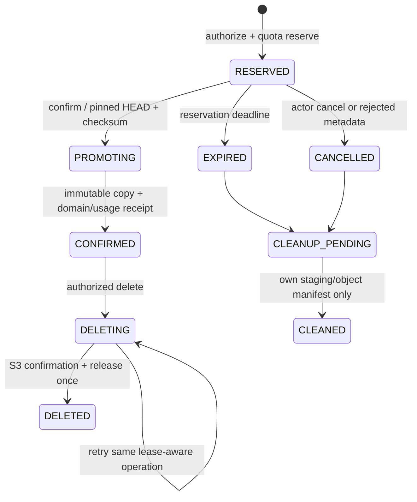

# Асинхронные операции, SQL, кэши и файлы — TAS-469

Срез кода: `af7ab57ead44304b89bbd47dabeeba45b761ce16`, 02.11.2026. Бизнес-основание: [D01–D249, Confluence v39](https://confluence.ozero.dev/pages/viewpage.action?pageId=60751880), B01/B12/B13/B14/B16/B18. **Ни tenant isolation, ни описанные ниже новые jobs этим документом не объявляются реализованными.** Реестр — результат анализа текущего `develop`, включая MCP, OAuth AS и восстановление workflow/type операций.

Машинный реестр [inventory/async-paths.json](inventory/async-paths.json) содержит 438 конкретных точек (`source`, `class`, `method`, `line`, `kind`, `evidence`) и 131 профиль пути. Каждый профиль задаёт владельца, scope, источник доверия, current/target, retry, dedup, fence и Jira-задачи реализации. Все 277 native SQL/JDBC вызовов и `@Query`, шесть R2dbcEntityTemplate select/count, пять точек построения SQL, 32 repository-интерфейса, 42 записи событий, пять publisher/DLT точек, listener, 16 scheduler методов, 21 cache/session-state точка, 24 S3 вызова, шесть startup hooks и три framework JDBC store constructors доступны отдельно; число — не число бизнес-операций.

Проверка из корня checkout: `python3 scripts/verify_async_inventory.py`. Она сравнивает независимый повторный scan всех `*/src/main/java/**/*.java` с зарегистрированными anchors и SHA-256 каждого источника. Новые/исчезнувшие anchors, изменённый исходник или отсутствующий профиль дают exit 1. Это проверка покрытия указанными лексическими правилами и дрейфа, не доказательство поведения runtime. Профили также включают семантически значимые классы без этих anchors: event envelope, factories, сериализаторы, обработчик уведомлений. Новый способ доступа к БД/очередям требует расширить правила scan в том же PR.

## 1. Фактические очереди и фоновые исполнители

Имена ниже разрешаются в точные пути/методы через JSON; одинаковые названия из разных модулей — разные записи.

| Владелец и путь в текущем коде | Сейчас | Целевой scope и изменение |
| --- | --- | --- |
| auth/project/issue `OutboxEventScheduler.publishOutboxEvents/recoverStuckEvents` | По два scheduled-метода в каждом сервисе; 3s publication/10s recovery по default конфигурации; batch 100, max attempts 5, processing timeout 5m | Три отдельных владельца; persisted scope из своей транзакции. Dispatcher выбирает только ID/scope, потом отдельная tenant transaction. TAS-318/326/489 |
| `kafka-lib` `AbstractOutboxEventPublisher.publish`, `AbstractOutboxEventProcessor.processOutboxEvents/processStuckEvents` | Общие sender/retry; key=aggregateId, статус по eventId; FAILED и stuck recovery. Подтверждение Kafka может предшествовать сбою mark published, значит дубли нормальны | key=`t:{tenantId}:{aggregateType}:{aggregateId}` либо `g:{scopeKind}:{scopeId}:{aggregateId}`; lease epoch CAS, envelope immutable; не переавторизовать уже совершившийся факт как новую команду. TAS-318/326 |
| auth `OutboxEventServiceImpl`, `EmailSignupTransaction`, `AdminInviteUserServiceImpl`, `AuthServiceImpl`, `AdminUserManagementServiceImpl`, `OAuthAccountService`, PAT service | user.events: приглашение/регистрация/активация/блокировка/PAT. Из signup/invite передаются приватные данные приглашения | GLOBAL_USER для security/account, TENANT только для tenant invitation; разрешённые типы определяет registry. Приватная доставка приглашения получает handle, raw token не идёт в общий Kafka. TAS-318/335/339/463/494 |
| project `OutboxEventServiceImpl` + callers | project.events: project created/archived и member added/updated/removed | TENANT из проекта в транзакции; membership changes несут generation, не роль из запроса. TAS-318/329/340/341 |
| issue `OutboxEventServiceImpl`, `IssueServiceImpl`, patch/transition/link/watcher/worklog/attachment executors, `CommentServiceImpl`, `LabelServiceImpl`, migration services | issue.events для CRUD/assignment/transition/comments/links/labels/watchers/worklogs/files; 42 anchors учитывают producer helpers/callers, а не только publisher | TENANT + project/issue ownership; события и history в той же транзакции; сериализация минимальных payload. TAS-318/343/362/363/364/365 |
| notification `TaskaEventsKafkaListener.onMessage` → `NotificationEventHandlerImpl.handle` | Один listener трёх topics; ручной ACK после transaction; dedup по eventId. Все `DuplicateKeyException` сейчас трактуются как повтор | Валидация producer/type/envelope до обработки; dedup только по конфликту конкретного unique key processed_event, не скрывать прочие constraint errors. TAS-318/325 |
| notification `KafkaConsumerConfig.kafkaListenerContainerFactory` | retry interval 3s, configured attempts 3, Spring DLT recoverer; отдельного DLT consumer/replay job не найдено | Ограниченные retries для transient; malformed scope/type — quarantine. В DLT сохранять безопасные envelope/error code, payload не раскрывать в admin API. Replay через контролируемую административную команду, same eventId/scope, повторная validation. TAS-326/350 |
| notification `NotificationDeliveryScheduler.email/telegram` → `NotificationDeliveryQueue` | 1s polls, max 8 attempts, lease ID, stale PROCESSING 2m, email batch 10/concurrency 4, Telegram batch 1 + общий throttle 1100ms; exponential 60s..3600s | TENANT или GLOBAL_USER отдельными таблицами/ветками; lease+generation CAS. Перед каждым send проверяются актуальные recipient/ACL/account, destination version; revoked → SUPPRESSED. TAS-325/326/489 |
| notification `NotificationDeliveryScheduler.housekeeping/observe` | Hourly TTL cleanup telegram links/updates/replies; 30s aggregate channel metrics | Global channel-control cleanup по собственным таблицам; tenant deliveries только scoped lease. Метрики EMAIL/TELEGRAM без tenant/user/payload labels. TAS-326/492 |
| notification `InvitationEmailScheduler.dispatch` → `InvitationEmailQueue.dispatchBatch/send/finish` | Private durable mail queue; 5s poll; token, email, expiry; SMTP at-least-once, lease compare-and-set | Private opaque deliveryHandle→server retrieval; tenant invitation version, sender admin generation, invite expiry/revocation before send. Повтор доставки не меняет reservation. TAS-335/339/326 |
| notification `TelegramUpdateService.process/command/reply` | Webhook secret; update dedup; link hash/user lock; durable bot reply | GLOBAL_USER channel binding, signed webhook secret; never accept arbitrary tenant from bot payload. Task links include tenant context and server rechecks. TAS-325/326 |
| auth `SignupCleanup.scheduled/cleanup` | Every 1m: batch 100 expired INVITED SIGNUP users; state recheck under row lock; IP limit cleanup | GLOBAL_USER_AUTH_FLOW. Не путать с tenant invitation expiry. Состояние ACTIVE/credential generation не удаляется по старому token. TAS-315/339 |
| auth `OAuthFlowStore.cleanup` | Hourly expiry cleanup states/codes/claims/rate limits | GLOBAL_USER_AUTH_FLOW. Одноразовые state/claim/purpose; не делать из social login интеграционный grant. TAS-315/498 |
| project `IssueTypeCreationCoordinator.recover/drive` | 5s recovery; durable issue_type_creations + reservation + commit/release | Scoped operation journal, immutable project/type generation. Новый служебный assertion, сохранённый original Header — только атрибуция. TAS-329/340/342/326 |
| project `IssueTypeDeletionCoordinator.recover/drive` | 5s recovery; issue_type_deletions/project_type_operations, issue migration receipt, workflow reservation | Same tenant across project/workflow/issue. APPLIED receipt finishes forward; stale cancellation never erases committed move. TAS-329/340/342/343/326 |
| workflow `WorkflowBindingCoordinator.recover/drive` | 5s recovery; PENDING/CANCELLING/COMPLETED/CANCELLED journal, project reservation, issue receipt | Tenant + operationId + generation at all hops; lease/CAS; forward finish committed receipt; new work requires current authorization. TAS-330/342/326 |
| issue `IssueTypeMoveService`, `WorkflowBindingMigrationService`, `WorkflowIssueMigrationService` | Internal migration RPC transactions, operation receipts, history/outbox per affected issue | Scoped worker identity, receipt key `(tenant,kind,operationId)`, project/issue/type/workflow predicates, original actor in history. TAS-332/342/343/326 |
| admin `OutboxRetryServiceImpl` → `OutboxRetryRepositoryImpl` | Narrow direct outbox writer; FAILED/stale PROCESSING→NEW, payload/attempts immutable, audit in own DB | Online administrative MODIFY + tenant-set/platform scope + operation permission. Scoped lookup/update, same eventId, CAS; platform audit hidden from tenant roles. TAS-346/350 |

Не найдены и **не являются текущими jobs**: tenant offboarding/account membership cleanup, storage reservation expiry/orphan cleanup, usage reconciliation, export build/expiry, quota reservation reconciliation, billing schedulers/webhook reconciliation. Их точные целевые протоколы ниже; в JSON `plannedPaths` они отделены от anchors. Нет фонового физического удаления текущих issue attachments: `AttachmentTransactionExecutor.deleteAttachment` делает DB soft-delete/history/outbox. Не объявлять освобождение S3/квоты реализованным.

Startup inventory: `auth.UserInitializer.run` — GLOBAL_PLATFORM bootstrap, target demo USER flag default=false (TAS-369) и операторское verified email GA (TAS-481). Пять `@PostConstruct` — `admin.MetadataService.validateClientsConfigured`, notification `InvitationEmailQueue.validateAcceptUrl`, `NotificationDeliveryQueue.validate`, `TelegramProperties.validate` и `api-gateway.OAuthController.validateUiBase`: это fail-fast config validation, не tenant job. Точные методы — JSON, ни один startup hook не должен выполнять tenant обход без явного purpose. Framework JDBC store constructors OAuth зарегистрированы отдельно от native SQL.

## 2. Доверенный event/worker protocol

JSON `eventRegistry` фиксирует все 34 текущие enum/wire event types, expected producer/topic/scope, точные emitter references и ветвь NotificationFactory (или отсутствие handler). UserInvited остаётся GLOBAL_USER для текущей auth invite/signup цепочки; tenant invitation — отдельный `TenantInvitationChanged` от tenant-service в `tenant.events` (schema v2, TENANT, payload только invitationId/state/version/senderId/reservationId; private delivery handle отдельным защищённым каналом), без смешения с глобальным signup. UNSUPPORTED отклоняется. Не все объявленные enum сейчас публикуются или создают inbox: это различие явно сохранено.

Target envelope v2 (общий contract TAS-318):

```json
{"schemaVersion":"2","id":"uuid","scopeKind":"TENANT","tenantId":"uuid","scopeId":"uuid","producerService":"issue-service","aggregateType":"ISSUE","aggregateId":"uuid","aggregateGeneration":"uuid","aggregateVersion":12,"eventType":"CommentCreated","occurredAt":"UTC instant","operationId":"uuid","requestId":"uuid","actor":{"kind":"USER","userId":"uuid","channel":"PAT","credentialId":"uuid","grantId":"uuid"},"payload":{"projectId":"uuid","issueId":"uuid","commentId":"uuid","actorUserId":"uuid"}}
```

Для TENANT `tenantId=scopeId` обязателен. GLOBAL_USER: `tenantId` отсутствует, `scopeId=userId`; GLOBAL_PLATFORM — фиксированный platform scope и allowlisted configuration/security types. Nullable tenant не означает глобальный доступ. Ни имя сервиса в JSON, ни actor role, ни срок пользовательского JWT не заменяют producer identity. Kafka topic ACL разрешает только владельца; consumer проверяет `producerService↔topic↔eventType↔scopeKind` registry, schema и существование owned aggregate/tombstone. При повреждении связи — quarantine, без DB effects. Для privacy/security сообщений общий envelope не содержит raw secret/token/URL. Kafka transport identity и ACL обеспечиваются TAS-317/318; если отдельная подпись envelope вводится, она проверяется по зарегистрированному producer key и не заменяет ACL.

`processed_events` unique `(scope_kind,scope_id,producer_service,event_id,handler)`. Inbox и channel jobs записываются атомарно с этим marker. Ordered aggregate consumers сравнивают `aggregateVersion`; пропуск/расхождение требует authoritative refresh, не применения старого snapshot. EventId тот же при retry/DLT/replay. Повтор после успешной обработки возвращает прежний результат и не меняет recipient/usage повторно.

Workers имеют собственную identity, а не perpetual GLOBAL_ADMIN. Их разрешение — `(workerPurpose,tenantId,operationId,aggregateGeneration,leaseEpoch)` из owned durable record. Claim: 60s lease, renew каждые 20s, batch <=100, новый lease epoch на reclaim. Для SMTP/Telegram сохраняется текущая минимальная lease 2m, превышающая network timeout; external delivery остаётся at-least-once при crash после send. Все completion/ack/release CAS проверяют lease epoch и состояние. Для миграций одного claim недостаточно: сохраняются существующие project/type write fences и receipt protocols. Восстановление не переиспользует просроченный user assertion; делает fresh signed service assertion с aud вызываемого сервиса.

```mermaid
sequenceDiagram
    participant API as Domain command
    participant DB as Owner DB
    participant P as Outbox worker
    participant K as Kafka
    participant N as Notification DB
    participant D as Delivery worker
    participant ACL as Auth + tenant + project
    API->>DB: tenant tx: domain + history + envelope
    P->>DB: claim IDs / tenant / lease epoch
    P->>K: validated immutable envelope / same eventId
    K->>N: validate registry; dedup + inbox + delivery tx
    N-->>K: ACK after commit
    D->>N: claim tenant delivery
    D->>ACL: online recipient / owner / channel epochs
    alt current access
        D->>D: render minimal authorized content and send
        D->>N: SENT CAS lease epoch
    else revoked / inaccessible
        D->>N: SUPPRESSED CAS; no content sent
    else dependency unavailable
        D->>N: RETRY with bounded backoff
    end
```

Факт уже совершённой операции можно опубликовать после блокировки автора: исторический actor не становится полномочием. Получатель проверяется заново. Для owner notices delivery хранит `purpose=OWNER_NOTICE,tenantId`, не право отправить бывшему владельцу. Перед send resolve current owner и transactionally replace unsent obsolete recipient; уже доставленное не повторяется без нового notice. Уведомление об изменении тарифа начинает notice window в момент первого обязательного inbox commit, SMTP retry дату не меняет. При owner transfer новый owner получает текущее состояние с исходным effectiveAt; финансовый payload прежнему owner запрещён.

## 3. Privacy и payload

`CommentServiceImpl.createCommentPayload/createUpdatePayload/createDeletePayload` **уже** не кладут body в history/outbox; там IDs/issueKey/actor и watcher IDs для create. Это сохраняется. Снимок watcher IDs — только кандидаты, он не выдаёт право отправки после удаления membership. Target consumer не доверяет старому body из legacy event; неизвестные поля удаляются allowlist serializer.

`PayloadSerializer` для иных issue changes содержит old/new description/summary, fileName и другие user-controlled поля. Target общий outbox хранит IDs, версии, изменённые field names и допустимые enum/счётчики; private body/description/credentials/пригласительные ссылки/presigned URL исключены. История может хранить разрешённые доменные изменения под tenant ACL, но не копию secret/raw payload; comment body — только comment entity. Notification по комментарию использует generic «Добавлен комментарий» и authenticated deep link; тело не дублируется в email/Telegram/outbox. Файловый key не публикуется как download capability.

Deleted-account tombstone применяется до отображения inbox/history/export и batch profile enrichment: «Удалённый пользователь», без старого имени/email/avatar snapshot; actor UUID остаётся во внутреннем аудите. Произвольный текст чужого комментария не переписывается автоматически. Logging: eventId/requestId/type/status достаточно; exception.message из внешнего провайдера/SQL не писать в outbox `last_error_message` или публичную ошибку без allowlist; безопасный reason + correlation ID. Метрики не содержат tenant names, email, issue titles, tokens.

## 4. Кэши и сессии — полный найденный набор

| Namespace/current key | Время жизни сейчас | Target key/trust/invalidation |
| --- | --- | --- |
| auth `OAuthProviderClient.keys[provider]` | Hard 5min; refresh on verification error | Global public provider keys. Key `(provider,issuer,configuredJwksUri)`; URL из token не принимается. Не включать tenant и не кэшировать пользовательскую authority |
| MCP `ToolResolver.Session.projects`, `projectLookups`, `issues`, `contexts`, `users` | Один invocation, `Mono.share`, отмена source при отмене всех subscribers | Фиксированный request context. В новой реализации explicit key `(scopeDigest,tenantId,subjectId,grantVersion,lookupKind,normalizedId)`; invocation-only, без продления на MCP session |
| project `ProjectServiceImpl.getProjectContext` issueType list `.cache()` | Локальный Mono в одном вызове | Только та же tenant/project context; не переносить в singleton |
| workflow `WorkflowScopeCheckService.check` defaultScope `.cache()` | Один вызов | Global immutable template только для чтения; copied tenant workflow требует tenant/binding/generation key |
| notification `queueDepth/queueAge[channel]` | Process lifetime counters | Global aggregate EMAIL/TELEGRAM, не authorization cache. Tenant identifiers не labels |
| OAuth AS `OAuthClients` registered-client setting `taska.metadata_until` | Persisted configured CIMD TTL, ограниченный Cache-Control; expiry/refetch | Global public client metadata key normalized client ID/URL; trusted allowlisted host/redirects, no private-network fetch. Tenant grant остаётся отдельным authoritative row |
| OAuth `OAuthBrowserSupport` HttpSessionRequestCache + `OAuthBackendController.CONSENT_STATE` + `SocialLoginController.NONCE` | Browser session/one-time flow state | CSRF/session bound; explicit selected tenant and scope snapshot confirmed in web; consume once. Saved authorize request не расширяет существующий grant |
| OAuth `OAuthRequestCorrelation.ATTRIBUTE`, logout request attribute | Один HTTP request | Только correlation/logout safe target, не cached permission |
| Gateway HTTP cache directives `/meta`, user directory/connected apps/auth; MCP auth response | private no-cache для meta, no-store для sensitive routes | Scope/tenant/policy version in ETag; auth before 304. No shared CDN cache, private content `Cache-Control: private, no-store` |

Target authorization caches (TAS-334/359) пока отсутствуют: `membership:v1:{tenant}:{user}:{membershipVersion}`, `projectAcl:v1:{tenant}:{project}:{user}:{aclVersion}`, `capabilities:v1:{tenant}:{entitlementVersion}:{flagsVersion}:{lifecycleVersion}`, `grant:v1:{grantId}:{grantVersion}`. Composite effective view также включает account securityVersion и scope digest. Обычное чтение — hard TTL <=30s от последней authoritative validation, не sliding TTL и не `stale-while-revalidate`. Events немедленно инвалидируют; event outage не удлиняет TTL. Негативный cache <=5s. Команда, download, issuance, recipient send и refresh/grant check идут online; при outage 503, без stale allow. Cache flush не является единственным механизмом отзыва. Config update уменьшает TTL/закрывает доступ немедленно, увеличение не продлевает уже выданный snapshot.

## 5. Native SQL и административные чтения

277 anchors перечислены по методу, месту вызова и файлу. SQL в строковой константе учитывается на месте исполнения `.sql`/`jdbc.query`, а все `@Query` отмечены отдельно. Список семейств не заменяет эти anchors:

| Семейство | Владельцы и обязательный predicate |
| --- | --- |
| auth repositories, signup/email transaction/IP limiter/OAuthAccount/OAuthFlow/PAT | Global user/flow tables остаются global; new tenant sessions/grants/invitations scoped; directory сначала tenant membership, затем global profile projection. User/email predicate не заменяет tenant grant |
| project repositories, ProjectWriteGuard, WorkflowTypeReservationTransactions | `tenant_id` перед joins/group/count/update/delete; project/type operation generation в журналах. Все children проверяются по composite ownership |
| issue repositories, `IssueRepositoryImpl`, `WorklogRepositoryCustomImpl`, `IssueTypeWriteGuard`, `WorkflowBindingPendingGuard` | scope в base relation до count/window/board LIMIT и обеих сторон link; history/comment/worklog labels/watchers/files/counters/idempotency/receipts tenant qualified; batch не enrichment произвольных IDs |
| workflow repositories, binding/reservation transactions, `WorkflowWriteFence`, `WorkflowScopeCheckService` | tenant+project+workflow/type generation во всех native SQL и nested statuses/transitions; global template отдельная read-only ветка |
| notification repository + Delivery/Invitation/Settings/Telegram SQL | Tenant inbox/preferences/processed events vs отдельные global account channel/security tables. Dispatcher изолирован от business rows; quota/metrics глобальные только агрегатные |
| OAuth AS `OAuthClients`, `OAuthGrantStore`, `ConnectedAppStore`, `OAuthBackendController`, `SingleUseCodeProvider`, `RotatingRefreshProvider` | JDBC authorization/consent/refresh family привязаны к auth.integration_grant; tenant-согласие уникально по tenant/scope, list/revoke не группируют чужую компанию в один неявный grant |
| admin `MetadataSchemaRepository`, `ReadOnlyRepository`, `AdminRepositoryCustomImpl`, `ReadOnlyQueryBuilder`, `OutboxRetryRepositoryImpl` | Explicit scope parameter вне user filter AST, до count/page/group/row-by-id. Tenant-set grant не читает global account/audit tables. Metadata allowlist фиксирована; строки/columns masking независимо от scope |
| common `SqlRenderer`, `SqlWhere`, `CriteriaRenderer` | Tenant predicate — обязательная внешняя конъюнкция, которую empty/OR/unknown пользовательский filter не может удалить |

БД-роли: `{service}_app`, `{service}_admin`, `{service}_job` — NOBYPASSRLS; DDL owner `{service}_migrator` не используется runtime. GLOBAL_ADMIN business bypass не означает BYPASSRLS. Platform query делает отдельные разрешённые tenant slices с обязательной scope validation; одна pooled connection никогда не содержит tenant A одновременно с B. `SET LOCAL`/`set_config(...,true)` только внутри одной transaction-bound connection; commit/rollback/cancel/timeout освобождают её без контекста. Root schema/data model описаны в TAS-303; matrix проверяет pool A→B после всех terminal signals (TAS-307/309).

## 6. Attachment/аватар: выбранный точный lifecycle

Текущий storage client выдаёт raw S3 URL (default 15m), случайный UUID key для вложений; avatar уже `avatars/{userId}/{uuid}` и проверка owner prefix. `HEAD` проверяет общий max size, но issued PUT не связывает сохранённый размер с quota reservation, content type не доказывает фактический формат, confirm вложения не доказывает владение ключом. S3 GET URL остаётся bearer capability после отзыва ACL. Эти пробелы закрывают TAS-347/365/366/367, а не текст документа.

Target namespaces:

- `tenant/{tenantId}/attachments/staging/{reservationId}/{randomUuid}` — только временный PUT;
- `tenant/{tenantId}/attachments/objects/{attachmentId}/{generation}` — immutable confirmed bytes, final key клиент никогда не получает для PUT;
- `tenant/{tenantId}/exports/{jobId}/{generation}` — только производный export;
- `global/users/{userId}/avatars/{avatarGeneration}` — global profile, tenant quota исключена;
- финансовые документы — отдельный billing-owned manifest и owner/admin access, не рабочий export.

`attachment_upload` manifest: `id,reservationId,tenantId,projectId,issueId,actorUserId,credentialId,operationId,expectedBytes,contentType,stagingKey,stagingVersionId,finalKey,checksumSha256,expiresAt,state,version,leaseEpoch`. Unique `(tenantId,actorUserId,operationId)`; payload hash фиксирует issue/type/size. States: RESERVED→PROMOTING→CONFIRMED; RESERVED→EXPIRED/CANCELLED; rejected bytes→CLEANUP_PENDING→CLEANED; confirmed deletion CONFIRMED→DELETING→DELETED. Manifest deletion tombstone остаётся для dedup; retention O09 отдельно.

1. Reserve: authoritative actor/tenant/project write ACL, upload flag и lifecycle; atomic usage admission `confirmedBytes + activeReservedBytes + request <= limit`. GLOBAL_ADMIN может превысить, но тот же счётчик. Max attachment 20,000,000 bytes, global avatar 2,000,000 bytes; значения — decimal bytes из бизнес-спеки, не текущее 2,097,152 в storage config. Reserve TTL 15min; PUT TTL min(5min, reserve expiry). Response содержит reservation ID, exact PUT headers и expiry; private no-store.
2. PUT: только staging key; size и content type bound to signed request where backend supports; server validation остаётся обязательной. Включённое object versioning либо эквивалентная immutable upload receipt — prerequisite storage adapter. Confirm фиксирует конкретный versionId, а не «последний объект по ключу». Без version-pinned source target feature не включать.
3. Confirm: recheck account/grant/membership/project/lifecycle и reservation ownership. Upload flag выключен после reserve — разрешён finish ранее принятой операции; новое admission запрещено. Повторный quota admission не нужен; pause/block/revocation не дают publish. HEAD конкретной версии + content inspection/declared MIME/размер/sha256. Фактический размер > reserve — reject, durable cleanup; не расширять резерв молча. Размер <=reserve фиксируется фактически, difference release один раз.
4. Promote: server-side copy конкретной staging version в immutable final key с проверкой source checksum; client PUT final key невозможен. Operation journal хранит итог object version/checksum. DB attachment + usage commit + history/outbox одной owned domain transaction/receipt; межсервисный quota commit через устойчивый reservation receipt. Crash после S3 copy до DB commit восстанавливается тем же ID; orphan record durable.
5. Read: API выдаёт authenticated download endpoint; gateway/owner делает online check при каждом GET/Range, expiry/ACL/tombstone и admin grant scope/level. Backend stream из S3 без reusable публичного S3 URL; response private/no-store и безопасный Content-Disposition attachment. Для долгого stream перепроверка access lease <=30s; уже выданные клиенту bytes отозвать невозможно. Так старый URL/Range не переживает отзыв доступа. Экспорт тем же путём, deadline от первого READY.
6. Delete: после authorized command поставить DELETING + outbox, немедленно закрыть чтение; worker удаляет конкретный final object version и staging versions своего manifest. Только подтверждённый DELETE/доказанный NoSuchKey даёт DELETED и release usage. S3 outage оставляет usage и retry; CAS+receipt исключают double release. Separate attachment delete запрещён при storage READ_ONLY; допустимы отдельный project offboarding и административное исключение.
7. Expiry/reconcile: claim only own expired manifests; release reserved bytes один раз, пока физический cleanup pending object недоступен через API. Reconcile confirmedBytes только по owner manifests/receipts и конкретному tenant; никогда по bucket-wide list. Удаление компании не сканирует global avatar prefix. Avatar replace сохраняет новый active generation транзакционно; старый blob удаляется durable cleanup, не best-effort swallow.



Для удалённого project/tenant generation любой старый upload/confirm/download запрещён, даже если ID или код проекта создан заново. Storage cleanup технический и не возрождает domain row. Clean-start TAS-370 сохраняет immutable manifest удаления прежних тестовых objects/events/queues; rollback/restore не replay старые нетенантные события в v2. Старые envelopes без scope карантинируются, не присваиваются «default tenant».

## 7. Новые workers: реализация уже определена

| Job и ticket | Durable key / scope | Admission, retry, completion |
| --- | --- | --- |
| Invitation expiry/revoke TAS-339 | tenant/invitation/generation; seat reservation | DELETE/expire CAS; release seat once; sender role revoked cancels unaccepted invites |
| Membership removal TAS-323/494 | tenant/user/membershipGeneration/operationId | Update assignment only where assignee and assignedMembershipGeneration match old generation; не снять нового исполнителя при retry |
| Project/seat/storage reservation reconcile TAS-322/324/347 | tenant/reservationId/resourceKind | Expired intent + no committed receipt → release; committed receipt → commit; unknown downstream → retry, не угадывать |
| Tenant provisioning TAS-337 | tenant/provisioningId/step | Own templates/project registry; step receipts, retries same IDs; ACTIVE only all mandatory receipts |
| First-paid auto-close TAS-478 | tenant/creationGeneration/deadline | CAS still pending/no timely-paid fact; CLOSED_AUTO distinct CANCELLED; late confirmation D216 can activate only auto-close with timely full payment |
| Entitlement/notice/catalog apply TAS-319/334/359/483 | tenant/subscriptionVersion/effectiveAt/noticeId | Refresh authoritative billing ledger; monotonic version; notify inbox once; email failure doesn't postpone effectiveAt |
| Billing reconcile/renewal TAS-331/353/355/488 | tenant/invoice/paymentAttempt/providerFactId | Confirm provider facts and currency/amount; idempotent ledger; pause/block/dispute prevents new autopay; already accepted attempt reconciled, not resent blindly |
| Export TAS-372 | tenant/requester/jobId/scopeDigest/lifecycleVersion | At enqueue + each page + download current ACL; if project access lost discard unauthorized partial archive and fail job, never publish broader archive; expiry 24h from first READY, no sliding extension |
| Tenant offboarding TAS-474 | tenant/deletionGeneration/step | Each domain marks/cleans own rows and file manifests; receipt per step; financial retention stays O09; never touch account/global avatar |
| Account deletion TAS-494 | user/securityVersion/operationId and per-tenant child operations | Owner/last-admin lock/guard before commit; revoke access first; membership cleanup idempotent; company pause/block/dispute don't stop D249 |
| Storage expiry/orphans TAS-347/367 | tenant or GLOBAL_USER / manifestId/generation | Lifecycle specified in §6; physical failure ≠ quota release; version-pinned delete |
| Fair scheduling TAS-489 | queueClass/tenant/cursor | Round-robin active tenant batches; concurrency <=2 per tenant and configurable global cap=16; global security queue separate bounded priority, cannot starve tenant jobs |

Для всех jobs ошибки permanent validation/state → terminal safe reason; dependency transient → exponential retry (base 1s, max 5min, full jitter), 10 technical attempts, затем quarantine с безопасным alert и контролируемым replay той же операции. Финансовый UNKNOWN не становится FAILED из-за бюджета попыток: отдельный reconciliation продолжает проверку принятого факта. Существующие baseline defaults outbox=5 и notification=8 выше описывают current code, не новый общий target default. Payload не переносится в alert. Мгновенно отменяются только ещё не принятые новые действия; принятую финансовую операцию, APPLIED receipt или deletion cleanup доводят по журналу. O04/O08/O09 блокируют только конкретное unresolved financial/retention действие, не сохранение факта и не технический retry.

## 8. Исполнимые критерии приёмки для coding tasks

- Две компании с одинаковыми project/issue keys; во всех 277 SQL anchors predicate действует до count/window/page, native query under app/admin/job role; pool A→B после success/error/cancel/timeout.
- Replay same event 2/20 раз и crash после Kafka ACK/до DB mark: один inbox/usage effect; DLT wrong tenant/schema/producer не создаёт rows; replay не меняет eventId/tenant.
- Recipient removed, suspended, transferred owner, account deleted, channel rebound между enqueue и send: no private delivery; dependency down — retry, не allow; old avatar/name snapshot не возвращается.
- Каждый из 16 scheduled methods запускается с реальным журналом/двумя tenant; stale lease completion CAS=0; reclaim не меняет tenant; workflow APPLIED completion survives restart.
- PAT/OAuth/MCP: tenant A grant + B object ID/SQL filter/cache key → concealment; read-only admin grant не retry outbox/не mark business notification read; stale grant cached >30s недопустим.
- Two uploads last byte capacity; repeated confirm; overwrite staging after confirm; cross-user/tenant key; oversized/mismatched MIME; failed S3 delete; reservation expiry racing confirm; revoke during Range stream; avatar unaffected by tenant cleanup.
- Export ACL removal mid-build + after READY; flag off after enqueue; expiry download at boundary; derived archive cleanup never deletes source files.

Проверки продукта пока не запускались: этот пакет меняет только аналитику и локальный checker. Их владельцы/порядок заданы Jira; runtime pass необходимо получить на итоговом PR head соответствующей реализации.
